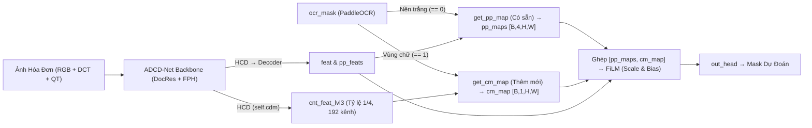

# KẾ HOẠCH TỔNG THỂ — ĐỒ ÁN NHÓM DATA SCIENCE (PHIÊN BẢN TINH GỌN & DỄ BẢO VỆ)

**Đề tài:** *Document Image Forgery Detection and Localization: Benchmarking and Adapting SOTA Methods*  
**Đối tượng thực hiện:** Nhóm 7 sinh viên năm cuối ngành Khoa học Dữ liệu (Data Science)  
**Thời gian thực hiện:** 8 tuần (`16/11/2026` – `12/01/2027`)  
**Triết lý thực hiện:** **Gọn – Sâu – Dễ hiểu cho cả 7 thành viên – Vững vàng khi bảo vệ trước hội đồng.** Tập trung vào thế mạnh của ngành DS (*khám phá dữ liệu, chống rò rỉ dữ liệu, sửa lỗi pipeline, Data/Resolution Adaptation và đánh giá thực nghiệm chặt chẽ*). Không làm web demo (Streamlit) để tránh gượng ép; các ý tưởng kỹ thuật nâng cao chuẩn bài báo quốc tế được tách mạch lạc vào phần **Future Work (Chương 5)**.

---

## I. Câu chuyện Bảo vệ 15 Phút (3 Đóng góp Cốt lõi Dễ Trình Bày)

Toàn bộ đồ án xoay quanh một mạch kể chuyện (storyline) rõ ràng, ai trong 7 thành viên cũng có thể tóm tắt trong 3 phút:

1. **Bước 1 — Bắt bệnh SOTA trên dữ liệu hóa đơn thực tế (Data Science Diagnosis):**
   - Benchmark 3 mô hình tiêu biểu (**TruFor**, **DTD**, **ADCD-Net**) trên tập hóa đơn thật `findit2` (*Find It Again!*, ICDAR 2023).
   - Chỉ ra **2 nguyên nhân gốc rễ** (về dữ liệu & kiến trúc) khiến SOTA gốc suy giảm trên hóa đơn thực tế — *lưu ý `DocTamper` vốn đã phân bố đều cả 3 loại giả mạo (Copy-Move, Splicing, Generation), nên vấn đề không phải do thiếu dữ liệu Copy-Move khi pre-train, mà do:*
     1. **Nút thắt độ phân giải (`val_max_size = 512`):** Hóa đơn có dạng dải dọc dài; khi bị ép cạnh dài nhất về 512 px, một con số bị sửa (`~9×16 px`) bị thu nhỏ chỉ còn vài pixel và biến mất.
     2. **Điểm mù Đồng nhất Nội ảnh & Channel Attention trước Copy-Move (`CPI`):** Khác với *Splicing* hay *Generation* (thường mang nhiễu ngoại lai, khác font/nền hoặc lệch lưới DCT dễ bị bắt bởi **Adaptive RGB-DCT Encoder (`FPH` + `Restormer`)** và nhánh nền sạch **`PPE`**), vùng *Copy-Move (`CPI`)* được lấy từ **chính tờ hóa đơn đó** nên đồng nhất hoàn toàn về nhiễu nền, mực in và lịch sử nén. Đồng thời, kiểm tra trực tiếp `ADCD-Net/model/restormer.py` (dòng 124–132) cho thấy khối `Attention` (`MDTA`) của Restormer chỉ tính tương quan **theo chiều Kênh (`C × C`)** chứ không phải **theo chiều Không gian (`HW × HW`)**, khiến mạng gốc chỉ bắt Copy-Move khi lộ viền cắt cứng chứ không đối sánh được sự trùng lặp không gian giữa vị trí nguồn và đích.
2. **Bước 2 — Thích nghi hóa Dữ liệu & Pipeline (Mốc An Toàn 1 — Bắt buộc):**
   - Tận dụng trực tiếp split chuẩn của `findit2` (bảo đảm **Zero Data Leakage**), sinh dữ liệu Copy-Move khoảng cách gần (`< 200 px`) trên hóa đơn sạch kết hợp **Poisson Blending (xóa đường cắt giả tạo để ép mô hình không học vẹt viền cắt)** & nén JPEG, pha trộn **60% Hóa đơn / 40% DocTamper** nhằm thu hẹp *Domain Shift* sang hóa đơn nhiệt.
   - Sửa lỗi kênh màu `BGR → RGB` trong `GeneralValDs` của repo gốc, nâng độ phân giải đánh giá (`val_max_size` lên `768/1024`), và Fine-tune `ADCD-Net` giữ nguyên 100% hàm Loss chuẩn.
3. **Bước 3 — Thích nghi hóa Kiến trúc Nhẹ (Mốc Nâng Cao 2 — Điểm nhấn):**
   - Phát hiện trong code `ADCD-Net/model/model.py`: nhánh **HCD** đã tách sẵn đặc trưng nội dung chữ (`cnt_feats`), nhưng lúc dự đoán (`is_train=False`) lại **bỏ trống không dùng**; trong khi nhánh **PPE** (`get_pp_map`) chỉ dùng phần nền trắng (`ocr_mask == 0`).
   - Nhóm bổ sung một hàm đối xứng **`get_cm_map`** (~25 dòng code) chỉ ở **1 tỷ lệ duy nhất (`1/4` — `cnt_feat_lvl3`)** kết hợp vùng chữ (`ocr_mask == 1`) để đo độ trùng lặp giữa các vùng chữ gần nhau, giúp hội đồng nhìn thấy ngay trực giác toán học chỉ qua 1 sơ đồ.

### Các mốc thời gian cứng (Hard Deadlines)
| Mốc thời gian | Sự kiện | Tiêu chí hoàn thành |
| :--- | :--- | :--- |
| **16/11/2026** | Khởi động dự án | Thống nhất pipeline, phân công 3 Squads, bắt đầu đọc hiểu code & bài báo. |
| **29/11/2026** | Báo cáo tiến độ 1 với GVHD | Xong EDA `findit2`, Sanity-check Reproduction (`ADCD-Net`) & Bảng Zero-shot Benchmark. |
| **06/12/2026** | **Mốc An Toàn 1** | Xong Fine-tune `ADCD-Net` trên dữ liệu 60/40 + đánh giá hiệu quả tăng `val_max_size`. |
| **13/12/2026** | **Mốc Nâng Cao 2** | Xong huấn luyện & đánh giá nhánh nhẹ `get_cm_map` (1 tỷ lệ `1/4`). |
| **20/12/2026** | **Code & Experiment Freeze** | Khóa toàn bộ code, checkpoint, bảng số liệu và hình ảnh minh họa. |
| **21/12/2026 – 11/01/2027** | Viết Báo cáo, Slide & Mock Defense | Hoàn tất báo cáo 5 chương, duyệt GVHD, làm slide và 2 buổi bảo vệ thử cả 7 người. |
| **12/01/2027** | **Nộp báo cáo chính thức** | Nộp bản PDF/in hoàn chỉnh và mã nguồn tái lập. |

---

## II. Phân bổ Nguồn lực (7 Thành viên – 3 Squads) & Hạ tầng

Hạ tầng hiện có của nhóm: **3 máy RTX 4060 8GB** (Viết, Quag, desktop Zam), **1 máy RTX 3050** (Zang), **laptop văn phòng** (Kiều, Mỹ, Thiết, laptop Zam), và **Server Lab (4 × RTX 3090 24GB)** để train chính thức.  
*(Theo dõi tiến độ chi tiết từng đầu việc theo từng cá nhân tại [TIEN_DO_CONG_VIEC.csv](./TIEN_DO_CONG_VIEC.csv)).*

| Tiểu nhóm | Thành viên & Vai trò | Hạ tầng sử dụng | Trách nhiệm chính (Gọn & Rõ ràng) |
| :--- | :--- | :--- | :--- |
| **Squad 1: Data & EDA** | - **Thiết** (Data Eng) - **Mỹ** (EDA, Visual QA & Slide Lead) | Laptop VP (+ nhờ GPU Viết/Zang khi chạy PaddleOCR) | - **Thiết:** Parse `findit2/{train,val,test}.txt` (chỉ tô `Original area=='no'`, loại `X51008114260.png`), sinh ~2.500 ảnh Synthetic Copy-Move (`< 200 px`, Poisson Blending, lưu `.jpg` QF 60–95) + tập Stress Test QF 70/50. - **Mỹ:** EDA trực quan hóa `findit2`, Visual QA 50 mẫu synthetic, xuất hình Explainability Figures & chủ trì Slide Deck bảo vệ. |
| **Squad 2: Model & Infra** | - **Viết** (Leader / PM & **Report Lead**) - **Quag** (Architecture & DataLoader Lead) - **Zang** (Server & Training Lead) | 2 × RTX 4060 (Viết, Quag) + RTX 3050 (Zang) + **Server 4×RTX 3090** | - **Viết:** Điều phối chung (PM), review/merge code, giữ mốc Code Freeze, **chủ biên & viết báo cáo chính** (Ch.1, Ch.4, Ch.5 & biên tập toàn cuốn), điều phối Mock Defense. - **Quag:** Giải phẫu `ADCD-Net`, vá lỗi `BGR → RGB` & viết DataLoader 60/40 (`AlignCrop 256`), thiết kế & debug `get_cm_map` (tỷ lệ `1/4`) trên RTX 4060, soạn nháp kỹ thuật Ch.3. - **Zang:** Dựng env đồng bộ (3050/4060/3090), chạy `seg_char.py` xuất `ocr_mask`, chạy Mốc 0 (Reproduction), Mốc 1 & Mốc 2 DDP trên 4×3090 + backup checkpoint. |
| **Squad 3: Benchmark, Eval & Academic** | - **Zam** (Benchmark & Eval Lead) - **Kiều** (Academic Advisor — *đang trao đổi tại Pháp, chậm VN 6h*) | Desktop RTX 4060 + Laptop VP (Zam) + Laptop VP (Kiều) | - **Zam:** Cài & chạy Zero-shot **TruFor, DTD, ADCD-Net gốc** trên RTX 4060, code `eval_metrics.py`, chấm điểm Mốc 1/Mốc 2, khảo sát `val_max_size` (`512` vs `768/1024`), Stress Test JPEG & bàn giao số liệu Ch.4 cho Viết. - **Kiều (Async VN–Pháp):** Soạn tài liệu tóm tắt SOTA cho nhóm, chốt công thức metrics, làm **Error Analysis**, soạn nháp Ch.2 (Cơ sở lý thuyết) & review học thuật chéo cho bản báo cáo chính của Viết. |

> **Quy ước phối hợp lệch múi giờ với Kiều (Pháp CET = UTC+1, chậm hơn VN 6 tiếng):** Các file/kết quả cần Kiều review gửi trước **15:00 VN (9:00 sáng Pháp)** để Kiều phản hồi trong ngày; họp Sync ngắn Thứ 4 & Chủ nhật cố định vào **20:30 VN (14:30 chiều Pháp)**.

---

## III. Thiết kế Dữ liệu & Tiền xử lý (Data-Centric & Zero Leakage)

### 1. Dùng trực tiếp split chuẩn của `findit2` (Không trộn SROIE rời)
- Toàn bộ **988 ảnh** của `findit2` (*Find It Again!*, ICDAR 2023) đã được lấy từ kho ảnh SROIE gốc và chia sẵn thành 3 tập tách biệt tuyệt đối:
  - **`findit2/train.txt`:** **577 ảnh** (**483 ảnh sạch**, **94 ảnh giả mạo** — loại bỏ 1 ảnh lỗi nhãn `X51008114260.png` có `forged=1` nhưng `forgery annotations=0`, còn **93 ảnh giả mạo hợp lệ**).
  - **`findit2/val.txt`:** **193 ảnh** (**159 ảnh sạch**, **34 ảnh giả mạo**).
  - **`findit2/test.txt`:** **218 ảnh** (**183 ảnh sạch**, **35 ảnh giả mạo**).
- Nhờ dùng trực tiếp 3 file split này, nhóm tiết kiệm toàn bộ thời gian lọc trùng thủ công mà vẫn đảm bảo **Zero Data Leakage** tuyệt đối.

### 2. Quy ước nhãn chuẩn trên `findit2` (`Original area: 'no'` vs. `'yes'`)
- Nhãn trong `findit2` là hình chữ nhật (`rect`). Với ảnh `CPI` (*Copy-Paste Inside*), dữ liệu gắn cả vùng đích bị dán đè (`Original area: 'no'`) và vùng nguồn (`Original area: 'yes'`, `Modified area: {'None': True}`).
- **Quy ước duy nhất cho toàn nhóm:** **Ground Truth Mask chỉ tô trắng vùng đích (`Original area: 'no'`)** (đồng nhất 100% với chuẩn của DocTamper, TruFor, DTD và ADCD-Net, tránh làm rối nhánh DCT/PPE bằng chữ thật ở vùng nguồn).

### 3. Tập Train, Validation và Tập Test duy nhất
1. **Tập Train (~5.000 mẫu — Tỷ lệ 60% Hóa đơn / 40% DocTamper):**
   - **60% Hóa đơn (~3.000 mẫu):**
     - **~2.500 ảnh Synthetic Copy-Move:** Sinh tự động chỉ từ **483 ảnh sạch trong `findit2/train`**. Dùng tọa độ bounding box chữ để copy cụm số/ngày tháng dán đè sang cụm số kích thước tương đương nằm trong **bán kính `< 200 px`** trên cùng tờ hóa đơn. Làm mượt biên bằng Poisson Blending / Feathering và lưu thành file **`.jpg`** (nén JPEG QF ngẫu nhiên 60–95).
     - **~500 mẫu từ 93 ảnh giả mạo thật hợp lệ trong `findit2/train`:** Nhân bản bằng Augmentation nhẹ (xoay/lật/chỉnh sáng + lưu `.jpg` QF 60–95).
     - *Lợi thế Data-centric:* Ràng buộc khoảng cách copy `< 200 px` (rất sát thực tế sửa giá/tổng tiền trong bảng hóa đơn) giúp cả vùng nguồn và vùng đích tự nhiên nằm gọn trong cửa sổ cắt **`AlignCrop(256, 256)`** có sẵn của `ADCD-Net/ds.py` mà không phải viết lại logic crop phức tạp!
   - **40% DocTamper Replay Buffer (~2.000 mẫu):** Lấy ngẫu nhiên từ tập Train của `doctamper_root/DocTamperV1` để giữ vững tri thức về Splicing, Removal và lưới DCT.
2. **Tập Validation:** Sử dụng trực tiếp **193 ảnh gốc của `findit2/val.txt`** (34 ảnh giả + 159 ảnh sạch) để chọn checkpoint tốt nhất.
3. **Tập Test chuẩn duy nhất (`findit2/test.txt` — 218 ảnh):**
   Không cần tự sinh thêm tập Test giả lập; chia 218 ảnh gốc của `findit2/test.txt` thành 3 lát cắt tự nhiên để đánh giá:
   - **Lát cắt 1 — Copy-Move thật (`CPI`):** **27 ảnh** mang nhãn `CPI`.
   - **Lát cắt 2 — Gian lận kiểu khác (`Control Set`):** **8 ảnh** giả mạo không chứa `CPI` (gồm các loại `CUT`, `IMI`, `PIX`, `CPO`) + tùy chọn một tập con 200 ảnh từ `doctamper_root` (`DocTamperV1-TestingSet`) để kiểm chứng không bị quên thảm họa.
   - **Lát cắt 3 — Ảnh sạch & Stress Test (`Pristine`):** **183 ảnh sạch** (đo FPR) + bản sao nén lại ở mức **JPEG QF = 70 và QF = 50** trên tập `test.txt` để đo độ bền vững.

### 4. Hai chỉnh sửa Pipeline quan trọng từ code gốc `ADCD-Net`
1. **Sửa lỗi kênh màu `BGR → RGB` trong `GeneralValDs` (`ADCD-Net/ds.py` dòng 397):** Code gốc dùng `cv2.imread(img_path)` (thứ tự BGR) rồi đưa thẳng vào `Image.fromarray(img)` trước khi `multi_jpeg` gọi `.convert("L")`, làm sai lệch trọng số kênh R và B khi tính độ chói Y. DataLoader đánh giá mới của nhóm bắt buộc chuyển `cv2.cvtColor(img, cv2.COLOR_BGR2RGB)` (hoặc đọc bằng `PIL.Image.open`).
2. **Mở nút thắt độ phân giải `val_max_size` (`ADCD-Net/cfg.py` dòng 38):** Thay vì ép cứng `val_max_size = 512`, nhóm thử nghiệm đối chiếu **`val_max_size = 512` vs. `768 / 1024`** để chứng minh hiệu quả giữ lại chi tiết các con số siêu nhỏ trên hóa đơn dài.

---

## IV. Thiết kế Mô hình & Thực nghiệm (Gọn, Sâu, Giữ Nguyên Loss Gốc)

### 1. Mốc 0: Sanity-check Reproduction (Yêu cầu của GVHD)
- Tận dụng nguyên bộ khung DDP + AMP `fp16` + TensorBoard có sẵn trong `ADCD-Net/main.py` và `ds.py` (không phải code lại từ đầu).
- Chạy huấn luyện từ khởi tạo `docres.pkl` trên **15–20% tập Train của `DocTamperV1`** trong **10–15 epochs** trên Server 4×RTX 3090 để xác minh quy trình hội tụ (Loss giảm đều, F1 tăng) báo cáo GVHD ở cuối Tuần 2.

### 2. Mốc 1 (An toàn): Data & Resolution Adaptation (Thu hẹp Domain Shift & Xử lý Độ phân giải)
- Nạp pre-trained weight `ADCDNet.pth`, giữ nguyên kiến trúc và **giữ nguyên 100% tổ hợp hàm Loss trong `ADCD-Net/main.py`** (`SoftCrossEntropyLoss` + `LovaszLoss` + `rec_l1` + `align_ce` + `supcon_parallel` + `norm_loss`).
- Fine-tune trên Tập Train 60/40 (Server 4×RTX 3090, `batch_size=32`, differential/low learning rate `~1e-5 – 5e-5`), kết hợp đánh giá ở `val_max_size = 768/1024`. Lưu ý: trong tập Train 60/40, việc áp dụng Poisson Blending lên ảnh Synthetic Copy-Move giúp loại bỏ các vết cắt cứng giả tạo, vừa giúp thu hẹp *Domain Shift* sang hóa đơn nhiệt `findit2`, vừa tạo nền dữ liệu sạch để ép mô hình phải tận dụng tín hiệu tương quan không gian ở Mốc 2 thay vì học vẹt đường viền cắt dán.

### 3. Mốc 2 (Nâng cao vừa sức): Kiến trúc Nhẹ `get_cm_map` (Bù đắp Điểm mù Không gian của MDTA ở tỷ lệ `1/4`)

- **Ý tưởng đơn giản (giải thích được trong 1 phút):**
  - Trong `ADCD-Net/model/model.py`, `get_pp_map` dùng `ocr_mask == 0` trên `pp_feats` để tìm độ giống với nền sạch (`pp_maps`).
  - Nhóm thêm hàm **`get_cm_map(cnt_feat_lvl3, ocr_mask, img_size)`** (~25 dòng code) ngay cạnh `get_pp_map`: lấy đúng **1 tầng `cnt_feats[2]`** (tỷ lệ `1/4`, 192 kênh — vốn đang bị bỏ trống khi inference), chuẩn hóa L2, dùng **`ocr_mask == 1`** che toàn bộ nền trắng, tính Cosine Similarity tự thân (loại trừ vùng lân cận cục bộ $|p-q| \le r$ để ký tự không tự khớp với chính nó), lấy giá trị max theo từng vị trí chữ rồi nội suy về `(img_size, img_size)` để ra **`cm_map` `[B, 1, H, W]`**.
  - Ghép `cm_map` vào cùng `pp_maps` (từ 4 kênh thành 5 kênh) qua `pp_scale_proj` / `pp_bias_proj` (hoặc một lớp `1×1 Conv` điều biến dư khởi tạo gần 0) để kết hợp tín hiệu trùng lặp chữ (`cm_map`) với tín hiệu nền sạch & dấu vết cắt dán (`pp_maps` + `frg_feats`).
- **Debug trước khi lên Server:** Thử trước 1–2 epochs trên máy **RTX 4060 (8GB)** với `fp16`, `batch_size=4`, `accum_step=8` để kiểm tra VRAM, sau đó đẩy lên **Server 4×RTX 3090** chạy DDP.

---

## V. Thước đo, Bảng Kết quả & Trực quan hóa

### 1. Thước đo Đánh giá (Gọn & Đầy đủ 3 khía cạnh)
1. **Localization (Chỉ tính trên 35 ảnh `forged == 1` của `findit2/test.txt`, tránh lỗi chia 0 của `compute_f1` gốc):**
   - **Box/Rect Pixel-F1 & IoU** (trên nhãn chữ nhật gốc của `findit2`).
   - **OCR-Intersected F1** (lấy giao `Rect_GT ∩ ocr_mask` để phản ánh sát độ khớp theo nét chữ).
2. **Detection (Trên toàn bộ 218 ảnh `findit2/test.txt`):** **Image-level ROC-AUC** (lấy Max hoặc Top-$k\%$ pixel xác suất cao nhất làm điểm ảnh).
3. **Độ sạch & Độ bền (Trên 183 ảnh sạch + bản nén JPEG QF 70, 50):** **Image-level FPR ($\downarrow$)** và **F1 sau khi nén**.

### 2. Bảng Kết quả Trung tâm cho Báo cáo & Slide
| Mô hình / Phiên bản | Copy-Move thật (`CPI` 27 ảnh: F1 / IoU) | Sửa kiểu khác (`Control` 8 ảnh: F1) | Toàn tập Test 218 ảnh (Image AUC) | 183 Ảnh sạch (Image FPR $\downarrow$) | Stress Test QF=50 (F1) |
| :--- | :---: | :---: | :---: | :---: | :---: |
| **1. TruFor** (Zero-shot, ảnh tự nhiên) | ... | ... | ... | ... | ... |
| **2. DTD** (Zero-shot, tài liệu) | ... | ... | ... | ... | ... |
| **3. ADCD-Net** (Zero-shot gốc, `val=512`) | ... | ... | ... | ... | ... |
| **4. ADCD-Net** (Zero-shot gốc, `val=768/1024`) | ... | ... | ... | ... | ... |
| **5. ADCD-Net + Data Adapt 60/40** *(Mốc 1)* | ... | ... | ... | ... | ... |
| **6. ADCD-Net + Data + `get_cm_map`** *(Mốc 2)* | **...** | **...** | **...** | **...** | **...** |

*(Ghi chú Ablation nhỏ đi kèm: so sánh ảnh hưởng của `val_max_size`, có/không dùng `ocr_mask` lọc nền trong `get_cm_map`, và Mốc 1 vs. Mốc 2).*

### 3. Trực quan hóa (Thay cho Demo)
Xuất sẵn **5–7 bộ ảnh minh họa chất lượng cao** đưa thẳng vào Slide và Báo cáo:
- **Hình so sánh đa mô hình:** `Ảnh gốc` $\rightarrow$ `Ground Truth` $\rightarrow$ `TruFor` $\rightarrow$ `DTD` $\rightarrow$ `ADCD-Net gốc` $\rightarrow$ `Mốc 1` $\rightarrow$ `Mốc 2`.
- **Hình giải phẫu 1 phút (`Explainability`):** `Input` $\rightarrow$ `ocr_mask` $\rightarrow$ `pp_maps (nhìn nền)` $\rightarrow$ `cm_map (nhìn cặp chữ trùng)` $\rightarrow$ `Output (chỉ khoanh vùng đích)`.
- **Hình Error Analysis:** Minh họa 2–3 ca thất bại (chữ quá mờ, `IMI` bắt chước font tự gõ không phải copy-paste) để thảo luận khách quan.

---

## VI. Lộ trình 8 Tuần Nhẹ Nhàng & Thực Tế (`16/11/2026` – `12/01/2027`)

- **Tuần 1 (`16/11 – 22/11/2026`) — Hiểu bài toán, EDA & Chuẩn hóa Dữ liệu:**
  - *Cả nhóm:* Đọc hiểu paper `ADCD-Net` và chạy thử luồng code có sẵn.
  - *Squad 1:* Làm EDA trên `findit2`, lọc `X51008114260.png`, chạy `seg_char.py` lấy `ocr_mask`, viết script sinh ~2.500 ảnh Synthetic Copy-Move (`< 200 px`, lưu `.jpg`).
  - *Squad 2:* Cài môi trường `ADCD-Net`, tải `docres.pkl` & `ADCDNet.pth`.
  - *Squad 3:* Cài `TruFor` và `DTD`, viết script chấm điểm thống nhất trên `findit2/test.txt`.
- **Tuần 2 (`23/11 – 29/11/2026`) — Sanity-check Reproduction & Zero-shot Benchmark:**
  - *Squad 2:* Chạy Sanity-check Reproduction của `ADCD-Net` trên 15–20% `DocTamperV1` (Server 4×3090), xuất biểu đồ TensorBoard báo cáo GVHD.
  - *Squad 3:* Chạy Zero-shot Benchmark (**TruFor, DTD, ADCD-Net gốc**) trên `findit2/test.txt`, thử nghiệm tác động của `val_max_size` (512 vs. 768/1024).
  - *Squad 1:* Kiểm tra chất lượng ảnh Synthetic và đóng gói bộ dữ liệu Train 60/40.
- **Tuần 3 (`30/11 – 06/12/2026`) — Mốc An Toàn 1 (`Data Adaptation`):**
  - *Squad 2:* Viết DataLoader `60/40` (sửa lỗi `BGR → RGB`), chạy Fine-tune `ADCD-Net` gốc trên 4×3090 (giữ nguyên hàm Loss gốc). Song song viết thử hàm `get_cm_map` (~25 dòng) trên máy 4060.
  - *Squad 3:* Chấm điểm toàn diện Mốc 1 trên `findit2/test.txt`.
  - *Leader (Viết) & Squad 1:* Bắt đầu phác thảo Chương 1 và phần dữ liệu của Chương 3.
- **Tuần 4 (`07/12 – 13/12/2026`) — Mốc Nâng Cao 2 (`get_cm_map`):**
  - *Squad 2:* Đẩy nhánh `get_cm_map` (1 tỷ lệ `1/4`) lên Server 4×3090 huấn luyện chính thức trên bộ 60/40.
  - *Squad 3:* Chấm điểm Mốc 2, chạy Stress Test (JPEG QF 70, 50) và thực nghiệm đối chứng nhỏ (có/không dùng `ocr_mask` trong `get_cm_map`).
- **Tuần 5 (`14/12 – 20/12/2026`) — Tổng hợp Hình ảnh & Khóa Code (`Code Freeze`):**
  - *Squad 3 & 1:* Xuất toàn bộ bảng biểu, biểu đồ và bộ hình giải phẫu `ocr_mask / pp_maps / cm_map` + Error Analysis.
  - *Cả nhóm:* Rà soát chéo số liệu, tổng hợp slide khung, dọn dẹp repo. **Khóa Code & Thực nghiệm tối 20/12/2026.**
- **Tuần 6 – Tuần 8 (`21/12/2026 – 12/01/2027`) — Viết Báo cáo, Làm Slide & Luyện Bảo vệ cho cả 7 người:**
  - *Tuần 6 (`21/12 – 27/12`):* Hoàn tất bản nháp báo cáo 5 chương, gửi GVHD duyệt.
  - *Tuần 7 (`28/12 – 03/01`):* Sửa theo góp ý GVHD, thiết kế Slide Deck cô đọng.
  - *Tuần 8 (`04/01 – 11/01`):* Tổ chức **2 buổi Mock Defense** để đảm bảo **cả 7 thành viên đều nắm vững từ EDA, Benchmark đến cơ chế `get_pp_map` / `get_cm_map`**. Nộp báo cáo ngày **12/01/2027**.

---

## VII. Cấu trúc Báo cáo 5 Chương & Định hướng Future Work (Chuẩn Bài Báo)

- **Chương 1 — Giới thiệu:** Bài toán gian lận hóa đơn, thách thức & đóng góp 3 bước của nhóm.
- **Chương 2 — Cơ sở Lý thuyết:** RGB vs. DCT forensics; tổng quan **TruFor**, **DTD**, **FFDN** (tham khảo lý thuyết) và giải phẫu **ADCD-Net** (Adaptive DCT, HCD, PPE).
- **Chương 3 — Phương pháp Đề xuất:** EDA & quy trình dữ liệu `findit2` (chống leakage, xử lý `Original area`, Synthetic Copy-Move `< 200 px`, hỗn hợp 60/40); sửa lỗi Pipeline (`BGR → RGB`, `val_max_size`); thiết kế nhánh nhẹ `get_cm_map` (tỷ lệ `1/4`).
- **Chương 4 — Thực nghiệm & Phân tích:** Kết quả Sanity-check Reproduction, Bảng Benchmark tổng hợp, Stress Test JPEG, phân tích `val_max_size`, trực quan hóa `pp_maps / cm_maps` và Error Analysis.
- **Chương 5 — Kết luận & Future Work (Định hướng Phát triển Thành Bài Báo Khoa học):**
  1. *Kiến trúc đa tỷ lệ & Global-Local Attention:* Mở rộng `get_cm_map` lên nhiều tầng (`1/4, 1/8`) kết hợp `CopyMoveAwareCrop` để bắt Copy-Move khoảng cách xa trên toàn tờ hóa đơn.
  2. *Truy vết cặp Source $\leftrightarrow$ Target dạng đồ thị:* Giải bài toán phân biệt rõ đâu là vùng nguồn và đâu là vùng đích thông qua đồ thị tương đồng và hàm Contrastive Loss chuyên biệt.
  3. *Tối ưu hàm Loss chuyên sâu & Benchmark mở rộng:* Thiết kế Auxiliary Loss cho bản đồ tương quan, mở rộng benchmark sang các mô hình Wavelet/Frequency (FFDN) và Vision-Language Models (VLM) trên tập dữ liệu đa ngôn ngữ quy mô lớn.

---

## VIII. Quy tắc Làm việc & Quản trị Rủi ro

1. **Không sửa trực tiếp thư mục tham chiếu gốc:** Giữ nguyên vẹn `findit2/`, `doctamper_root/` và bản gốc `ADCD-Net/` (khi chỉnh sửa code, copy sang thư mục làm việc riêng hoặc tạo nhánh Git riêng).
2. **Lưu Checkpoint & Log tự động:** Server 4×3090 có thể ngắt phiên đột xuất; lưu checkpoint định kỳ và đồng bộ TensorBoard log ra ngoài.
3. **Cố định Random Seed:** Lưu seed và metadata sinh dữ liệu Synthetic thành file `.json`/`.csv` để đảm bảo tái lập 100%.
4. **Họp đồng bộ 15 phút (Thứ 4 & Chủ nhật hàng tuần):** Đảm bảo không bạn nào bị rớt lại phía sau trong quá trình đọc hiểu đề tài.
