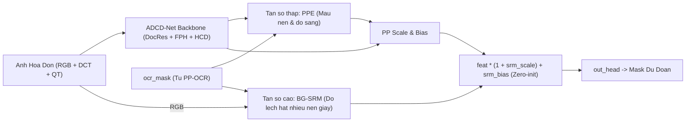

# KẾ HOẠCH TỔNG THỂ — ĐỒ ÁN NHÓM DATA SCIENCE (HƯỚNG B: AI-ASSISTED DOCUMENT FORENSICS)

**Đề tài:** *Document Image Forgery Detection and Localization: Benchmarking and Adapting SOTA Methods*  
**Đối tượng thực hiện:** Nhóm 7 sinh viên năm cuối ngành Khoa học Dữ liệu (Data Science)  
**Thời gian thực hiện:** 8 tuần (`16/11/2026` – `12/01/2027`)  
**Trạng thái hiện tại (`26/11/2026`):** Đã kiểm chứng phần cứng & dữ liệu gốc (`DocTamperV1` 120k LMDB, `T-SROIE_test` 1.579 ảnh khớp ID `findit2`, `ADCDNet.pth`, `docres.pkl`, `jpeg2dct`), vá lỗi nền tảng trong [src/ds.py](./src/ds.py), và cập nhật thiết kế **Hướng B (Phương án 3A — Mở rộng Đa Generator & Lý giải Tần số Cao/Thấp)** sau phản hồi của GVHD (`25/11`) và góp ý tiền bối.  
**Triết lý thực hiện:** **100% miền Tài liệu & Hóa đơn (Document/Receipt) – Chống rò rỉ dữ liệu tuyệt đối – Lý giải xử lý tín hiệu chặt chẽ – Tránh ôm đồm mô hình từ đầu.** Giữ loại bỏ `OSTF_test` (ảnh cảnh tự nhiên/poster) khỏi Train & Test chính để bảo vệ nhánh nền giấy `PPE`.

---

## I. Câu chuyện Bảo vệ 15 Phút & Định vị Học thuật

Toàn bộ đồ án xoay quanh mạch kể chuyện nhất quán trên **đúng 1 miền Tài liệu & Hóa đơn**, làm rõ 3 đóng góp chính:

1. **Bước 1 — Bắt bệnh SOTA trên Hóa đơn Đa nguồn AI (Benchmark & Empirical Diagnosis):**
   - **Định vị SOTA chuẩn xác:** Theo Bảng 1 bài báo gốc **ICCV 2025** ([ADCD-Net/fig/docpro.png](./ADCD-Net/fig/docpro.png)), `ADCD-Net` đang giữ **Top 1 toàn cục (`Avg. All = 0.588`)**, **Top 1 liên miền (`Avg. C = 0.450`)**, và **Top 1 trên bộ hóa đơn `T-SROIE` (`0.623` > `CAT-Net` `0.609` > `FFDN` `0.533` > `DTD` `0.525` > `TruFor` `0.213`)** *(chỉ đứng sau `FFDN` ở In-Domain `DocTamper`: `0.771` vs. `0.813`)*. Khác với nhánh kiểm tra logic OCR/toán học trên `FindItAgain!` (dễ bị qua mặt nếu kẻ gian sửa khớp cả đơn giá lẫn tổng tiền), hướng **Visual/Frequency Forensics** của nhóm phát hiện gian lận trực tiếp ở mức pixel.
   - **Khoảng trống thực tế:** Bản thân `ADCD-Net` gốc mới chỉ được train trên tài liệu tổng quát (`DocTamperV1`) rồi đem sang hóa đơn chạy Zero-shot, chưa được thích nghi hóa cho **kết cấu giấy in nhiệt & phông chữ nhỏ của hóa đơn** và **các thế hệ Diffusion / Inpainting hiện đại** (`SD-1.5 Inpainting`, `AnyText`, `TextDiffuser`, công cụ thương mại `ChatGPT/Gemini`), cũng như suy giảm khi ảnh qua nén mạng xã hội (`QF 70, 50`).
2. **Bước 2 — Thích nghi hóa Dữ liệu Đa Generator & Tách Biến Nhiễu (Mốc An Toàn 1 — Data Adaptation):**
   - **Zero Data Leakage tuyệt đối:** Mọi hóa đơn chia rạch ròi theo ID gốc của `findit2/{train,val,test}.txt` (1 hóa đơn không bao giờ nằm ở cả Train và Test).
   - **Loại bỏ biến nhiễu Xóa vs. Sửa & Khảo sát Miền huấn luyện của Generator (theo góp ý GVHD `25/11`):**
     - Không để tình trạng CNN chỉ làm *Xóa* (`LaMa`) còn Diffusion chỉ làm *Sửa* (`AnyText`). Nhóm bổ sung **`SD-1.5 Inpainting`** làm nhiệm vụ *Removal* tương đương `LaMa` ngay lúc Train/Test, và bổ sung **`TextDiffuser`** (miền tài liệu/OCR `MARIO-10M`) song hành với **`AnyText`** (đa miền `AnyWord-3M`) ở tập *Unseen Test*.
     - Chuẩn hóa đủ **3 hành vi gian lận hóa đơn**: *Removal* (xóa dòng/chiết khấu), *Replacement* (sửa số tiền/ngày tháng), *Insertion* (chèn dòng khống vào vùng trống).
     - Bổ sung **Test Set 4 — Commercial AI Wild Case Study (`~25–30` ảnh)** từ `ChatGPT (gpt-image-1)` / `Gemini Image Editing` / `Canva` để kiểm chứng tính thực chiến và giới hạn của mô hình open-source trước công cụ thương mại.
   - **Vá 3 lỗi ngầm của repo gốc:** (1) `BGR → RGB` trong `GeneralValDs`, (2) fallback `ocr_mask` khi thiếu `.pkl` trong `src/ds.py`, (3) đặt `min_qf = 65` ngay từ Epoch 1 khi Fine-tune và bật `enable_grad_checkpointing` chạy vừa `GPU 8GB`.
3. **Bước 3 — Thích nghi hóa Kiến trúc Nhẹ `BG-SRM` & Lý giải Tần số Cao vs. Tần số Thấp (Mốc Nâng Cao 2 — Điểm nhấn):**
   - **Quyết định trọng tâm:** **KHÔNG tự build/train model mới từ con số 0** trên 483 hóa đơn sạch (sẽ overfit nặng và kém xa SOTA pretrained 120k ảnh). Thay vào đó, nhóm nâng cấp `ADCD-Net` bằng nhánh **Background-Guided Truncated SRM (`BG-SRM`)** song song với nhánh tần số thấp `PPE`.
   - **Giải đáp dứt điểm câu hỏi "Edge Detection?" của GVHD:** Nhánh `BG-SRM` dùng 3 bộ lọc thông cao `SRM 5×5` cố định kết hợp **(i) cắt ngưỡng biên độ `[-3, +3]`** để triệt tiêu mép chữ đen–trắng (`0 → 255`), và **(ii) đối chiếu phương sai nhiễu tần số cao với nền giấy chuẩn (`ocr_mask == 0`)** để bắt vùng *quá mượt (over-smoothing)* hoặc *nhiễu lưới giải mã (VAE/upsampling artifacts)*, giữ nguyên `ADCDNet.pth` và 6 hàm loss gốc.

### Các mốc thời gian cứng (Hard Deadlines)
| Mốc thời gian | Sự kiện | Tiêu chí hoàn thành |
| :--- | :--- | :--- |
| **26/11/2026** | **Cập nhật Thiết kế 3A+ (Sau họp GVHD)** | Mở rộng 5 open-source Generators + Case Study `GPT/Gemini`, chốt lý thuyết `BG-SRM` & hạ tầng `Server 2×RTX 4000 (8GB)`. |
| **29/11/2026** | **Báo cáo tiến độ 1 với GVHD** | Xong EDA, Sanity-check Reproduction (`Mốc 0` trên `2×RTX 4000 8GB`), xong dữ liệu Seen + Unseen AI & Bảng Zero-shot. |
| **06/12/2026** | **Mốc An Toàn 1** | Xong Fine-tune `ADCD-Net` nguyên bản trên Tập Train Đa Generator 60/40 (`Server 2×RTX 4000 8GB`). |
| **13/12/2026** | **Mốc Nâng Cao 2** | Xong huấn luyện `ADCDNetWithBGSRM` + đánh giá đủ 4 tập Test (Seen, Unseen, Pristine/Stress, Commercial AI). |
| **20/12/2026** | **Code & Experiment Freeze** | Xong Ablation Study (Mốc 1 vs. Mốc 2) + phân tích Generator Training Domain, khóa code tag `v1.0-freeze`. |
| **21/12/2026 – 11/01/2027** | **Báo cáo, Slide & Mock Defense** | Hoàn tất Báo cáo 5 chương, duyệt GVHD, hoàn tất Slide Deck và 2 buổi bảo vệ thử cả 7 người. |
| **12/01/2027** | **Nộp báo cáo chính thức** | Nộp bản PDF/in hoàn chỉnh và repository GitHub tag `v1.0-freeze`. |

---

## II. Phân bổ Nguồn lực (7 Thành viên – 3 Squads) & Hạ tầng

Hạ tầng hiện có (cập nhật `21–26/11/2026`):
- **Server Lab được GVHD cấp:** **1 server gồm `2 × Quadro RTX 4000 (8GB)`** *(kiến trúc Turing, Compute Capability `7.5` — hỗ trợ tốt `fp16` AMP / Tensor Cores, **không dùng `bf16`**; truy cập SSH public key)*. Dùng để chạy DDP 2 GPU + `fp16` AMP + `enable_grad_checkpointing()` (`bs = 4/GPU × 2 GPU × accum_step = 4` $\Rightarrow$ `effective batch size = 32`) cho **Mốc 0, Mốc 1, Mốc 2**.
- **Cloud Miễn phí cho Diffusion nặng:** **Kaggle (`T4 16GB` / `2×T4`) hoặc Google Colab (`T4 16GB`)** chạy 1 lần (~15–25 phút) sinh ảnh **`AnyText`** và **`TextDiffuser`** (vì mỗi model cần `~10–12 GB VRAM`), rồi tải về lưu cố định trên server.
- **Máy cá nhân của nhóm:** **3 × RTX 4060 8GB** (Viết, Quag, desktop Zam), **1 × RTX 3050** (Zang), và **laptop văn phòng** (Kiều, Mỹ, Thiết).

*(Theo dõi tiến độ chi tiết từng đầu việc tại [TIEN_DO_CONG_VIEC.csv](./TIEN_DO_CONG_VIEC.csv)).*

| Tiểu nhóm | Thành viên & Vai trò | Hạ tầng sử dụng | Trách nhiệm chính |
| :--- | :--- | :--- | :--- |
| **Squad 1: Data & AI Synthesis** | - **Thiết** (Data Eng) - **Mỹ** (EDA, Visual QA & Slide Lead) | Laptop VP + RTX 4060 (`LaMa`, `SD-1.5`) + Kaggle/Colab (`AnyText`, `TextDiffuser`) | - **Thiết:** Split `T-SROIE_test` theo ID `findit2` (`998/255/326`); viết `gen_ai_findit2.py` sinh **`LaMa`** (`~1.400` mảnh) và **`SD-1.5 Inpainting`** (`~800` mảnh Removal + 5–10 mẫu thử viết chữ minh họa *Generator Domain*); chuẩn bị mảnh `512×512` + mask 3px cho `AnyText` & `TextDiffuser` (đủ Removal/Replacement/Insertion); tạo Stress Test `QF 70, 50`. - **Mỹ:** EDA `T-SROIE`, `findit2`, `DocTamperV1`; tạo **Test Set 4 Commercial AI (~25–30 hóa đơn bằng `ChatGPT/Gemini/Canva`)**; Visual QA 50+ mẫu đa nguồn; xuất hình 300 DPI (`PPE` vs `BG-SRM`, lỗi `SD-1.5`) & chủ trì **Slide Deck**. |
| **Squad 2: Model & Infra** | - **Viết** (Leader / PM & **Report Lead**) - **Quag** (Architecture & DataLoader Lead) - **Zang** (Server & Training Lead) | 2 × RTX 4060 (Viết, Quag) + RTX 3050 (Zang) + **Server `2×RTX 4000 (8GB)`** + Kaggle `T4 16GB` | - **Viết:** Điều phối chung (PM), review/merge PR, giữ Code Freeze, **chủ biên Báo cáo chính** (Ch.1, Ch.4, Ch.5 & biên tập toàn cuốn), tổ chức Mock Defense. - **Quag:** Viết `src/ds_hybrid.py` (60% `T-SROIE + LaMa + SD-1.5` / 40% `DocTamperV1`, `min_qf=65` từ Epoch 1); nâng cấp **`BG-SRM`** (`Truncation [-3, +3]` + đối chiếu phương sai nền giấy `ocr_mask == 0`) & `enable_grad_checkpointing` vào `src/model/model.py` (không tự build model from scratch); viết nháp Ch.3. - **Zang:** Dựng env đồng bộ trên **Server `2×RTX 4000 (8GB)`** (`dl_workers=4`, `TMPDIR=/dev/shm`) & chạy batch `AnyText` + `TextDiffuser` trên **Kaggle/Colab `T4 16GB`**; chạy `seg_char.py` xuất `ocr_mask`; chạy DDP **Mốc 0, Mốc 1, Mốc 2** + backup checkpoint. |
| **Squad 3: Benchmark, Eval & Academic** | - **Zam** (Benchmark & Eval Lead) - **Kiều** (Academic Advisor — *đang trao đổi tại Pháp, chậm VN 6h*) | Desktop RTX 4060 + Laptop VP (Zam) + Laptop VP (Kiều) | - **Zam:** Cài & chạy Zero-shot **TruFor, DTD, ADCD-Net gốc** trên RTX 4060; viết `scripts/eval_metrics.py`; chấm điểm Mốc 1, Mốc 2 trên cả **4 tập Test** (Seen 3 nguồn, Unseen `AnyText` + `TextDiffuser`, Pristine/Stress `QF 70/50`, Commercial AI `GPT/Gemini`). - **Kiều (Async VN–Pháp):** Soạn note lý thuyết **Tần số cao vs. Tần số thấp (SRM ≠ Edge Detection)** và **Generator Training Domain**; chốt Metrics Protocol; làm **Error Analysis** (Commercial AI, font nhỏ, `QF=50`); viết nháp Ch.2 & review chéo cho Viết. |

> **Quy ước phối hợp lệch múi giờ với Kiều (Pháp CET = UTC+1, chậm hơn VN 6 tiếng):** Gửi tài liệu cần Kiều review trước **15:00 VN (9:00 sáng Pháp)**; họp Sync ngắn Thứ 4 & Chủ nhật cố định vào **20:30 VN (14:30 chiều Pháp)**.

---

## III. Thiết kế Dữ liệu Chuẩn (100% Hóa đơn — Đa Generator & Zero Data Leakage)

### 1. Nguồn dữ liệu gốc đã xác minh trong Workspace
- **`T-SROIE_test/` (`1.579` ảnh `512×512` JPG):** Khớp 100% ID hóa đơn `findit2`: **`998` ảnh thuộc `train.txt`**, **`255` thuộc `val.txt`**, **`326` thuộc `test.txt`** (`0` ảnh ngoài).
- **`findit2/` (`988` ảnh PNG hóa đơn thật):** `train.txt` (`483` sạch, bỏ qua dòng lỗi `X51008114260.png`), `val.txt` (`159` sạch), `test.txt` (`183` sạch).
- **`doctamper_root/` (`DocTamperV1 -> archive`):** `TrainingSet` (`120.000`), `TestingSet` (`30.000`), `FCD` (`2.000`), `SCD` (`18.000`) + `qt_table.pk` + `pks/`.
- *(Giữ loại bỏ `OSTF_test/` khỏi Train & Test chính, chuyển sang Chương 5 Future Work.)*

### 2. Bảng Generator Zoo & Phân tích Miền Huấn luyện Gốc (Trả lời góp ý GVHD & Tiền bối)

| Generator | Kiến trúc | Miền dữ liệu huấn luyện gốc | Hành vi gian lận đảm nhận | Vai trò trong Đồ án | Hạ tầng chạy |
| :--- | :--- | :--- | :--- | :--- | :--- |
| **`T-SROIE` (`SRNet`)** | Style-aware GAN | Chữ tổng hợp & tài liệu | *Replacement* (sửa chữ) | **Seen AI** (Train / Val / Test 1) | Có sẵn (`1.579` ảnh) |
| **`LaMa`** | Fourier CNN (`FFC`) | Ảnh cảnh tự nhiên (`Places2`) | *Removal* (xóa dòng/số) | **Seen AI** (Train / Val / Test 1) | Laptop `RTX 4060` (`~2 GB`) |
| **`SD-1.5 Inpainting`** | Latent Diffusion | Ảnh cảnh tự nhiên (`LAION`) | *Removal* (xóa dòng/số) + *5–10 mẫu thử viết chữ* | **Seen AI** (Train / Val / Test 1 — *khử biến nhiễu CNN vs. Diffusion*) | Laptop `RTX 4060` (`~4 GB FP16`) |
| **`AnyText`** | Diffusion + ControlNet | Ảnh chữ đa miền (`AnyWord-3M`) | *Replacement* & *Insertion* | **Unseen AI** (Test Set 2) | Kaggle/Colab `T4 16GB` (~15p) |
| **`TextDiffuser` *(hoặc `TextDiffuser-2` / `MOSTEL`)*** | Diffusion *(hoặc GAN dự phòng)* | Poster & Tài liệu OCR (`MARIO-10M`) | *Replacement* (sửa số tiền/ngày) | **Unseen AI** (Test Set 2 — *đối chứng Generator chuyên chữ tài liệu*) | Kaggle/Colab `T4 16GB` (~15p) |
| **`ChatGPT / Gemini / Canva`** *(Commercial)* | Proprietary Multimodal / Diffusion | Đa phương thức quy mô lớn | Sửa tự do bằng prompt (cục bộ & nguyên trang) | **Test Set 4 — Wild Case Study** *(đo giới hạn thực chiến)* | Web/App miễn phí (`~25–30` ảnh) |

> **Phân tích học thuật từ bảng trên (đưa vào Ch.3 & Ch.4):** Các model train trên *ảnh tự nhiên* (`LaMa`, `SD-1.5 Inpainting`) phục hồi nền giấy trơn khá tự nhiên khi **Removal**, nhưng khi ép viết chữ mới (`SD-1.5`) chữ sẽ méo/sai ngữ nghĩa (*bằng chứng trực quan khẳng định nhận định của GVHD*). Ngược lại, `AnyText` và `TextDiffuser` được huấn luyện trên dữ liệu chữ/OCR (`AnyWord-3M`, `MARIO-10M`) nên viết được số tiền sắc nét, đặt ra thách thức thực sự cho hệ thống phát hiện.

### 3. Phân chia Train / Val / Test (Phương án 3A+ — Tuyệt đối tách theo ID `findit2`)
1. **Tập Train (`~4.300` mẫu/epoch — 60% Hóa đơn AI / 40% `DocTamperV1`):**
   - **60% Receipt AI (`~2.500` mẫu — Seen AI từ ID `findit2/train.txt`):**
     - `998` ảnh **`T-SROIE`** (GAN *Replacement*).
     - `~1.000` mảnh `512×512` **`LaMa-FindIt2`** (CNN *Removal* trên 483 hóa đơn sạch).
     - `~500` mảnh `512×512` **`SD15-Inpaint-FindIt2`** (Diffusion *Removal* trên 483 hóa đơn sạch).
     - Tất cả áp dụng Resize ngẫu nhiên + nén **JPEG `QF ∈ [65, 100]` ngay từ Epoch 1** (bỏ `init_S = 0`).
   - **40% `DocTamperV1-TrainingSet` (`~1.800` mẫu/epoch):** Replay buffer giữ vững kiến thức tài liệu tổng quát và lưới DCT.
2. **Tập Validation (`~555` mẫu — Theo ID `findit2/val.txt`):**
   - `255` **`T-SROIE`** + `~200` **`LaMa-FindIt2`** + `~100` **`SD15-Inpaint-FindIt2`** (từ 159 hóa đơn sạch).
3. **Bộ 4 Tập Test Chuẩn (`100%` từ ID `findit2/test.txt` — Tuyệt đối chưa thấy khi Train/Val):**
   - **Test Set 1 — Seen AI (`~726` ảnh):** `326` `T-SROIE` + `~200` `LaMa` + `~200` `SD-1.5 Removal`.
   - **Test Set 2 — Unseen Open-Source AI (`~400–450` ảnh):** `~250` **`AnyText-FindIt2`** (*Replacement + Insertion*) + `~150–200` **`TextDiffuser-FindIt2`** (*Replacement*), thực hiện trên mảnh `512×512` của 183 hóa đơn sạch `findit2/test`, **bắt buộc ghép biên mềm Gaussian 3px**: $I_{\text{out}} = M \odot I_{\text{AI}} + (1 - M) \odot I_{\text{orig}}$ để giữ nguyên độ nét các chữ không sửa xung quanh. *(Nếu `TextDiffuser` gặp hạn chế trên chữ in nhiệt siêu nhỏ, ghi nhận định lượng + chuyển phương án dự phòng `MOSTEL` và đưa phân tích vào Limitations).*
   - **Test Set 3 — Pristine Control & JPEG Stress Test:** `183` ảnh sạch `findit2/test` (đo **Image-level FPR ($\downarrow$)**) + bản sao nén **JPEG `QF = 70` và `QF = 50`** của Test Set 1 & 2.
   - **Test Set 4 — Commercial AI Wild Case Study (`~25–30` ảnh):** Hóa đơn `findit2/test` sửa qua `ChatGPT (gpt-image-1)` / `Gemini` / `Canva` (chia 2 nhánh nhỏ: *ghép vùng sửa cục bộ* để tính Pixel-F1 và *ảnh xuất nguyên trang* để kiểm tra Image-level Detection + phân tích giới hạn khi AI tái tạo toàn bộ nền giấy).

---

## IV. Thiết kế Mô hình, Lý thuyết Tần số & Thực nghiệm (Giữ Nguyên Loss Gốc)

### 1. Giải thích Khoa học: Tần số Thấp vs. Tần số Cao (`BG-SRM` ≠ Edge Detection)

1. **Dải Tần số Thấp (`PPE` `get_pp_map` sẵn có):** Gom đặc trưng vùng nền không chữ (`ocr_mask == 0`) ở các tầng thu nhỏ $\rightarrow$ đo độ đồng nhất **màu giấy, độ sáng, bóng đổ vĩ mô**. Bắt tốt cắt-dán thủ công nhưng **bị AI đánh lừa** vì Diffusion/GAN hòa trộn màu nền mượt tuyệt đối.
2. **Dải Tần số Khối `8×8` (`FPH` DCT sẵn có):** Bắt **lệch lưới lượng tử JPEG kép**, nhưng suy yếu khi ảnh hóa đơn gốc (PNG) được AI sửa rồi mới nén 1 lần qua mạng xã hội.
3. **Dải Tần số Cao (`BG-SRM` đề xuất — Tại sao KHÔNG PHẢI Edge Detection?):**
   - Nhắm vào **hạt nhiễu vi mô của giấy in nhiệt & cảm biến**. Vùng AI tạo thường bị **mượt bất thường (*over-smoothing*)** hoặc xuất hiện **nhiễu lưới giải mã (*VAE/upsampling artifacts*)**.
   - Để tránh biến thành bộ dò biên chữ (*Edge Detection* bắt bước nhảy `0 → 255` của nét chữ), nhánh `BG-SRM` áp dụng **2 chốt chặn kỹ thuật**:
     1. **Truncation / Clamping (`[-3, +3]`):** Cắt bão hòa các đáp ứng biên độ cực lớn tại cạnh chữ đen–trắng, chỉ giữ dao động biên độ nhỏ của nền giấy.
     2. **Background-Guided Variance Normalization (`ocr_mask == 0`):** Dùng `ocr_mask` cô lập vùng nền giấy không chữ của chính tờ hóa đơn đó, đo mức **chênh lệch năng lượng nhiễu tần số cao cục bộ so với nền giấy thật** (tương tự cơ chế đối chiếu mẫu chuẩn của `PPE`, nhưng trên miền tần số cao).
   - Toàn nhánh chỉ tăng rất nhẹ tham số (`~1k` params), điều biến dư khởi tạo `0` trước `out_head`, bảo toàn 100% `weights/ADCDNet.pth` và **6 hàm loss gốc** trong `src/main.py`.

### 2. Ba Mốc Thực nghiệm & Ablation Công bằng
1. **Mốc 0 — Sanity-check Reproduction (`29/11`):** Train `src/main.py` từ `weights/docres.pkl` (đủ 6 loss gốc) trên **15–20% `DocTamperV1-TrainingSet`** trong **10–15 epochs** trên **Server `2×RTX 4000 (8GB)`** (`bs=4/GPU, accum=4`).
2. **Mốc 1 (Ablation Baseline) — Multi-Generator Data Adaptation (`06/12`):** Nạp `weights/ADCDNet.pth`, giữ nguyên 100% kiến trúc & 6 loss gốc, Fine-tune trên Tập Train 60/40 (`T-SROIE + LaMa + SD-1.5 + DocTamperV1`, `min_qf=65`).
3. **Mốc 2 (Proposed) — `ADCDNetWithBGSRM` (`13/12`):** Fine-tune trên **cùng dữ liệu và siêu tham số** như Mốc 1 (`lr=1e-5` backbone, `1e-4` nhánh `BG-SRM`). *(Nếu kịp quỹ GPU sẽ chạy thêm lượt ablation `Vanilla SRM` vs. `BG-SRM` để chứng minh định lượng tác dụng của đối chiếu nền giấy `ocr_mask`).*

---

## V. Thước đo, Bảng Kết quả & Trực quan hóa

### 1. Thước đo Đánh giá
1. **Localization (trên ảnh giả `forged == 1`):** **Pixel-level F1** và **IoU**.
2. **Detection (toàn tập gồm ảnh giả + `183` ảnh sạch):** **Image-level ROC-AUC** (Max hoặc Top-$k\%$ pixel xác suất).
3. **Độ sạch & Độ bền (Test Set 3):** **Image-level FPR ($\downarrow$)** trên 183 ảnh sạch và **Pixel-F1** ở **JPEG `QF = 70, 50`**.

### 2. Bảng Kết quả Trung tâm cho Báo cáo & Slide

| Mô hình / Phiên bản | Seen: `T-SROIE` (326: F1/IoU) | Seen: `LaMa + SD-1.5` (400: F1/IoU) | **Unseen**: `AnyText` (250: F1/IoU) | **Unseen**: `TextDiffuser` (150–200: F1/IoU) | **Wild**: `GPT/Gemini` (25–30: AUC/F1) | 183 Ảnh sạch (FPR $\downarrow$) | Stress `QF=50` (F1) |
| :--- | :---: | :---: | :---: | :---: | :---: | :---: | :---: |
| **1. TruFor** *(Zero-shot, ảnh tự nhiên)* | ... | ... | ... | ... | ... | ... | ... |
| **2. DTD** *(Zero-shot, tài liệu)* | ... | ... | ... | ... | ... | ... | ... |
| **3. ADCD-Net** *(Zero-shot `ADCDNet.pth`)* | ... | ... | ... | ... | ... | ... | ... |
| **4. ADCD-Net + Đa Generator 60/40** *(Mốc 1)* | ... | ... | ... | ... | ... | ... | ... |
| **5. ADCD-Net + Data + `BG-SRM`** *(Mốc 2 — Ours)* | **...** | **...** | **...** | **...** | **...** | **...** | **...** |

### 3. Trực quan hóa (Thay cho Web Demo)
Xuất 6–8 bộ hình (300 DPI) theo mẫu [poc_out/vis_comparison.png](./poc_out/vis_comparison.png):
- Grid so sánh các mô hình trên cả **Removal (`LaMa` vs. `SD-1.5`)**, **Replacement/Insertion (`AnyText`, `TextDiffuser`)** và **Commercial AI (`GPT/Gemini`)**.
- Hình đối chiếu **Bản đồ Tần số thấp `PPE` vs. Bản đồ Tần số cao `BG-SRM`** (chứng minh không bắt nhầm nét chữ).
- Hình minh họa **Ảnh hưởng của Generator Training Domain** (VD: `SD-1.5` viết chữ biến dạng vs. `AnyText` sắc nét).

---

## VI. Lộ trình 8 Tuần (`16/11/2026` – `12/01/2027`)

- **Tuần 1 (`16/11 – 22/11/2026`) — Chốt Phương án, Env & Script Dữ liệu:**
  - *Đã xong (`18–22/11`):* PoC RTX 4060, sửa symlink `DocTamperV1` (120k LMDB), vá `src/ds.py`, tạo `AGENTS.md`, nhận cấp phép **Server `2×RTX 4000 (8GB)`** (chờ gán SSH key).
  - *Cả nhóm:* Thiết viết `split_tsroie_by_findit2.py` & `gen_ai_findit2.py`; Mỹ vẽ EDA; Quag viết `src/ds_hybrid.py`; Zam viết `scripts/eval_metrics.py`; Kiều soạn note lý thuyết.
- **Tuần 2 (`23/11 – 29/11/2026`) — Reproduction (`Mốc 0`), Sinh Đa Generator & Zero-shot:**
  - *Squad 1 & Zang:* Thiết chạy `LaMa` + `SD-1.5 Inpainting` (Removal + 5–10 mẫu thử viết chữ) trên RTX 4060; Zang chạy `AnyText` (~250 ảnh) & `TextDiffuser` (~150–200 ảnh) trên **Kaggle/Colab `T4 16GB`**, chạy `seg_char.py` lấy `ocr_mask`, và chạy **Mốc 0** trên **Server `2×RTX 4000 (8GB)`** báo cáo GVHD `29/11`; Mỹ làm Visual QA + chuẩn bị `~25–30` mẫu **Commercial AI (`GPT/Gemini/Canva`)**; Thiết nén Stress Test `QF 70, 50`.
  - *Squad 3:* Zam chạy Zero-shot (**TruFor, DTD, ADCD-Net gốc**) trên đủ 4 tập Test.
- **Tuần 3 (`30/11 – 06/12/2026`) — Mốc An Toàn 1 (`Fine-tune Đa Generator 60/40`):**
  - *Squad 2:* Zang chạy DDP **Mốc 1** trên **Server `2×RTX 4000 (8GB)`** (`bs=4/GPU, accum=4`); Quag tích hợp `BG-SRM` (`Truncation` + đối chiếu nền giấy `ocr_mask == 0`) & `enable_grad_checkpointing` vào `src/model/model.py`.
  - *Squad 3 & PM:* Zam chấm điểm Mốc 1; Viết dựng khung Báo cáo Chương 1.
- **Tuần 4 (`07/12 – 13/12/2026`) — Mốc Nâng Cao 2 (`ADCDNetWithBGSRM`):**
  - *Squad 2:* Zang train DDP **Mốc 2** trên **Server `2×RTX 4000 (8GB)`** (và chạy Ablation `Vanilla SRM` nếu kịp giờ GPU).
  - *Squad 3:* Zam chấm điểm Mốc 2 trên đủ 4 tập Test, Stress Test `QF 70, 50` và tổng hợp bảng Ablation.
- **Tuần 5 (`14/12 – 20/12/2026`) — Hình ảnh, Error Analysis & `Code Freeze`:**
  - *Mỹ & Kiều:* Xuất hình 300 DPI (`PPE` vs `BG-SRM`, Heatmap, Generator Domain) & viết Error Analysis (Commercial AI tái tạo toàn ảnh, chữ quá nhỏ, `QF=50`).
  - *Viết:* Rà khớp 100% số liệu, cập nhật `README.md` và **KHÓA CODE (`v1.0-freeze`) tối 20/12/2026**.
- **Tuần 6 – Tuần 8 (`21/12/2026 – 12/01/2027`) — Viết Báo cáo Chính, Slide & Mock Defense:**
  - *Tuần 6 (`21/12 – 27/12`):* Kiều giao Ch.2, Quag/Thiết giao Ch.3; **Viết** viết Ch.1, Ch.4, Ch.5 và biên tập toàn cuốn gửi GVHD `27/12`.
  - *Tuần 7 (`28/12 – 03/01`):* Mỹ hoàn tất Slide Deck (`03/01`); Viết chỉnh sửa theo góp ý GVHD.
  - *Tuần 8 (`04/01 – 11/01`):* **2 buổi Mock Defense** (`20:00 VN = 14:00 CET`), chốt PDF/in và **nộp ngày 12/01/2027**.

---

## VII. Cấu trúc Báo cáo 5 Chương & Future Work

- **Chương 1 — Giới thiệu:** Gian lận hóa đơn bằng AI đa thế hệ, khoảng trống giữa tài liệu tổng quát với hóa đơn/AI thương mại & đóng góp 3 bước.
- **Chương 2 — Cơ sở Lý thuyết:** Tần số thấp vs. DCT khối `8×8` vs. tần số cao, dấu vết Generator (GAN `SRNet`, CNN `LaMa`, Diffusion `SD-1.5`/`AnyText`/`TextDiffuser`, Commercial AI), đối chiếu **TruFor, DTD, ADCD-Net** (kèm phân tích tách biệt với nhánh OCR-logic `FindItAgain!`).
- **Chương 3 — Phương pháp Đề xuất:** Chiến lược dữ liệu 100% Hóa đơn chống rò rỉ theo ID `findit2`, phân tích **Miền huấn luyện gốc của Generator**, vá lỗi `src/ds.py`, kiến trúc **`BG-SRM`** (chứng minh không phải Edge Detection nhờ *Truncation* & *Background Variance Normalization*).
- **Chương 4 — Thực nghiệm & Phân tích:** Reproduction (`Mốc 0`), Bảng Benchmark 4 tập Test, Ablation (Zero-shot vs. Mốc 1 vs. Mốc 2 `BG-SRM`), Stress Test `QF 70/50`, Case Study `ChatGPT/Gemini`, trực quan hóa `PPE` vs `BG-SRM` & Error Analysis.
- **Chương 5 — Kết luận & Future Work:**
  1. **Mở rộng Cross-domain sang Ảnh Cảnh tự nhiên:** Thử nghiệm thích nghi trên `OSTF` (9 bộ sinh AI ngoài trời/poster).
  2. **Kiến trúc chuyên biệt & Đa phương thức chống Commercial AI:** Kết hợp nhánh Visual/Frequency Forensics với **OCR Logical/Arithmetic Consistency** (và dữ liệu huấn luyện quy mô lớn để chống full-image regeneration từ `GPT/Gemini`).
  3. **Bổ sung nhánh Copy-Move (`get_cm_map`) & Fine-tune toàn bộ đối trọng:** Thử nghiệm thêm `Flux Fill`, `SDXL`, và fine-tune cả `TruFor`, `DTD`, `FFDN` trên cùng tập hóa đơn AI.

---

## VIII. Quy tắc Quản trị Rủi ro

1. **Giữ nguyên thư mục tham chiếu gốc:** Không sửa `ADCD-Net/`, `findit2/`, `doctamper_root/archive/`, `T-SROIE_test/`. Code phát triển đặt trong `src/` và `scripts/`.
2. **Chống tràn VRAM `8GB` khi dev & train DDP:** Luôn bật `enable_grad_checkpointing()`, dùng `bs >= 2` (`BatchNorm1d` trong `dct_align_head`), `drop_last=True`; trên server `2×RTX 4000 (8GB)` (Turing CC `7.5`) chỉ dùng **`fp16` AMP (không dùng `bf16`)**, chạy `bs=4/GPU × 2 × accum=4` + `dl_workers=4` + `TMPDIR=/dev/shm`.
3. **Backup Checkpoint & Cố định Seed:** Đồng bộ checkpoint mỗi epoch ra ngoài server và lưu seed/ID split vào `.json`.
4. **Sync 2 buổi/tuần (`20:30 VN = 14:30 CET` Thứ 4 & Chủ nhật):** Đảm bảo Kiều tại Pháp và cả nhóm đồng bộ liên tục.
