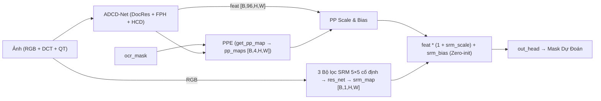

# KẾ HOẠCH TỔNG THỂ — ĐỒ ÁN NHÓM DATA SCIENCE (HƯỚNG B: AI-ASSISTED MANIPULATION)

**Đề tài:** *Document Image Forgery Detection and Localization: Benchmarking and Adapting SOTA Methods*  
**Đối tượng thực hiện:** Nhóm 7 sinh viên năm cuối ngành Khoa học Dữ liệu (Data Science)  
**Thời gian thực hiện:** 8 tuần (`16/11/2026` – `12/01/2027`)  
**Trạng thái hiện tại (`18/11/2026`):** Đã hoàn tất PoC kiểm chứng phần cứng & trọng số thật trên RTX 4060 ([scripts/poc_option_b.py](./scripts/poc_option_b.py)), chính thức chốt chuyển sang **Hướng B (AI-Assisted Manipulation — Bản Tối Giản cho Đồ án Môn học)**.  
**Triết lý thực hiện:** **Thực tế – Thời sự – Dễ hiểu cho cả 7 thành viên – Vững vàng khi bảo vệ.** Không làm Web Demo (Streamlit/Gradio) để tránh gượng ép và tràn 8GB VRAM; không cài `AnyText` nặng nề vì đã có sẵn `T-SROIE_test` (1.579 ảnh) và `OSTF_test` (3.046 ảnh từ 9 bộ sinh AI), kết hợp **`LaMa`** siêu nhẹ (~2GB VRAM) để tự sinh thêm ca xóa/sửa trên hóa đơn sạch `findit2`.

---

## I. Câu chuyện Bảo vệ 15 Phút (3 Đóng góp Cốt lõi Dễ Trình Bày)

Toàn bộ đồ án xoay quanh một mạch kể chuyện rõ ràng, trực quan mà cả 7 thành viên đều có thể trình bày trôi chảy:

1. **Bước 1 — Bắt bệnh SOTA trước Chỉnh sửa Bằng AI (Empirical Diagnosis):**
   - Benchmark 3 mô hình tiêu biểu (**TruFor**, **DTD**, **ADCD-Net**) trên dữ liệu chỉnh sửa bằng AI gồm: hóa đơn GAN (`T-SROIE_test`), đa bộ sinh AI (`OSTF_test` — chia riêng nhóm **GAN**: *SRNet, MOSTEL, STEFANN* và nhóm **Diffusion**: *AnyText, TextDiffuser, UDiffText, DiffSTE*), cùng hóa đơn `findit2` chỉnh sửa bằng AI Inpainting (`LaMa`).
   - **Phát hiện thực nghiệm đã được PoC chứng minh:** `ADCDNet.pth` gốc bắt khá tốt GAN đời cũ (`T-SROIE`: Pixel-F1 `0.6505`, `OSTF-GAN`: `0.5770`), nhưng **suy giảm mạnh trước AI Diffusion thế hệ mới (`OSTF-Diffusion`: `0.2698`)** và **AI Inpainting trên hóa đơn (`0.1770`)**, do vùng ảnh AI vẽ lại làm mất hạt nhiễu giấy tự nhiên và để lại vân giải mã tần số cao ở biên chữ.
2. **Bước 2 — Thích nghi hóa Dữ liệu & Pipeline (Mốc An Toàn 1 — Data Adaptation):**
   - Xây dựng tập Train lai **60% Dữ liệu AI / 40% DocTamper** tuân thủ **Zero Data Leakage** (tách nghiêm ngặt theo ID hóa đơn gốc trên `T-SROIE`, tách riêng các công cụ **Seen AI** khi train và **Unseen AI** khi test để chứng minh không học vẹt 1 công cụ AI).
   - Dùng **`LaMa`** (nhẹ ~2GB VRAM) tự sinh thêm ca xóa/chỉnh sửa trên 483 ảnh sạch `findit2/train`.
   - Vá lỗi kênh màu `BGR → RGB` trong `GeneralValDs` (`src/ds.py`), cài `jpeg2dct` (`libjpeg-dev`) và áp dụng **`enable_grad_checkpointing`** cho RTX 4060 8GB (giảm VRAM train `bs=4` từ OOM xuống **`~3.49 GB`**), giữ nguyên 100% hàm Loss gốc của `ADCD-Net/main.py`.
3. **Bước 3 — Thích nghi hóa Kiến trúc Nhẹ `SRMHighFreqBranch` (Mốc Nâng Cao 2 — Điểm nhấn):**
   - Tích hợp 3 bộ lọc pháp y **SRM 5×5 cố định** (*Spatial Rich Models*) + khối `res_net` nhẹ (**chỉ `+960` tham số = `0.004%`** tổng `23.24M` tham số) điều biến dư lên `feat` trước `out_head`.
   - **Ưu điểm tuyệt đối:** Giữ nguyên đầu vào 6 kênh của `Restormer`, nạp nguyên vẹn trọng số pre-trained `ADCDNet.pth` (`Unexpected keys: 0`), dễ giải thích bằng trực giác vật lý (khuếch đại nhiễu vi kết cấu hạt giấy và dấu vết upsampling của VAE/Diffusion).
   - **Tín hiệu PoC ban đầu:** Chỉ sau 30 steps (`38.1s`) trên RTX 4060, `OSTF-Diffusion` tăng từ `0.2698` $\rightarrow$ **`0.4092` (`+0.1394`)**, `OSTF-GAN` từ `0.5770` $\rightarrow$ **`0.6929` (`+0.1160`)**. Trong bản chính thức sẽ chạy **Ablation Study chuẩn** tách riêng *Mốc 1 (Fine-tune không SRM)* vs. *Mốc 2 (Fine-tune + SRM)*.

### Các mốc thời gian cứng (Hard Deadlines)
| Mốc thời gian | Sự kiện | Tiêu chí hoàn thành |
| :--- | :--- | :--- |
| **18/11/2026** | **Chốt Hướng B (Sau PoC)** | Hoàn tất PoC `scripts/poc_option_b.py` trên RTX 4060, chốt kế hoạch & phân công 7 người. |
| **29/11/2026** | **Báo cáo tiến độ 1 với GVHD** | Xong EDA, Sanity-check Reproduction (`Mốc 0`), xong dữ liệu `LaMa` + split Seen/Unseen & Bảng Zero-shot Benchmark. |
| **06/12/2026** | **Mốc An Toàn 1** | Xong Fine-tune `ADCD-Net` gốc trên tập Train 60/40 (`Data Adaptation`) trên Server 4×3090. |
| **13/12/2026** | **Mốc Nâng Cao 2** | Xong huấn luyện `ADCDNetWithSRM` + đánh giá đầy đủ trên Seen AI, Unseen AI, Pristine & Stress Test JPEG. |
| **20/12/2026** | **Code & Experiment Freeze** | Xong Ablation Study (Mốc 1 vs. Mốc 2), khóa toàn bộ code, checkpoint, bảng số liệu và hình Heatmap. |
| **21/12/2026 – 11/01/2027** | **Báo cáo, Slide & Mock Defense** | Hoàn tất Báo cáo 5 chương, duyệt GVHD, hoàn tất Slide Deck và 2 buổi bảo vệ thử cả 7 người. |
| **12/01/2027** | **Nộp báo cáo chính thức** | Nộp bản PDF/in hoàn chỉnh và repository GitHub tag `v1.0-freeze`. |

---

## II. Phân bổ Nguồn lực (7 Thành viên – 3 Squads) & Hạ tầng

Hạ tầng hiện có: **3 máy RTX 4060 8GB** (Viết, Quag, desktop Zam), **1 máy RTX 3050** (Zang), **laptop văn phòng** (Kiều, Mỹ, Thiết, laptop Zam), và **Server Lab (4 × RTX 3090 24GB)** để train chính thức.  
*(Theo dõi tiến độ chi tiết từng đầu việc tại [TIEN_DO_CONG_VIEC.csv](./TIEN_DO_CONG_VIEC.csv)).*

| Tiểu nhóm | Thành viên & Vai trò | Hạ tầng sử dụng | Trách nhiệm chính |
| :--- | :--- | :--- | :--- |
| **Squad 1: Data & AI Synthesis** | - **Thiết** (Data Eng) - **Mỹ** (EDA, Visual QA & Slide Lead) | Laptop VP (+ dùng chung RTX 4060 của Viết/Zam khi chạy `LaMa`) | - **Thiết:** Chia tách chống leakage `T-SROIE_test` (theo ID hóa đơn gốc) & `OSTF_test` (tách riêng **Seen vs. Unseen AI**); chạy **`LaMa`** xóa/inpaint chữ trên 483 ảnh sạch `findit2/train` và `findit2/test`; tạo tập Stress Test nén JPEG (`QF 70, 50`). - **Mỹ:** EDA trực quan hóa bộ dữ liệu AI (`T-SROIE`, `OSTF`, `findit2`), Visual QA ảnh `LaMa`, xuất hình Explainability/Heatmap & chủ trì **Slide Deck** bảo vệ. |
| **Squad 2: Model & Infra** | - **Viết** (Leader / PM & **Report Lead**) - **Quag** (Architecture & DataLoader Lead) - **Zang** (Server & Training Lead) | 2 × RTX 4060 (Viết, Quag) + RTX 3050 (Zang) + **Server 4×RTX 3090** | - **Viết:** Điều phối chung (PM), review/merge PR, giữ mốc Code Freeze, **chủ biên & viết Báo cáo chính** (Ch.1, Ch.4, Ch.5 & biên tập toàn cuốn), tổ chức Mock Defense. - **Quag:** Vá lỗi `BGR → RGB` trong `GeneralValDs`, viết `ReceiptAIHybridDs` (60/40), tích hợp chuẩn `SRMHighFreqBranch` vào `src/model/model.py` (kèm `enable_grad_checkpointing` để debug `bs=4` trên 4060), soạn nháp kỹ thuật Ch.3. - **Zang:** Dựng env đồng bộ (`jpeg2dct`, `libjpeg-dev`, `PaddleOCR`), chạy `seg_char.py` xuất `ocr_mask`, chạy **Mốc 0** (Reproduction), **Mốc 1** (Fine-tune) & **Mốc 2** (`+ SRM`) DDP trên `4×3090` + backup checkpoint. |
| **Squad 3: Benchmark, Eval & Academic** | - **Zam** (Benchmark & Eval Lead) - **Kiều** (Academic Advisor — *đang trao đổi tại Pháp, chậm VN 6h*) | Desktop RTX 4060 + Laptop VP (Zam) + Laptop VP (Kiều) | - **Zam:** Cài & chạy Zero-shot **TruFor, DTD, ADCD-Net gốc** trên RTX 4060, code `eval_metrics.py`, chấm điểm Mốc 1, Mốc 2 (tách rõ Seen AI, Unseen AI, Pristine FPR), Stress Test JPEG & bàn giao số liệu Ch.4 cho Viết. - **Kiều (Async VN–Pháp):** Soạn tài liệu đọc hiểu SOTA (bao gồm lý giải `SRM`, `VAE/Diffusion artifacts`), chốt Metrics Protocol, làm **Error Analysis**, soạn nháp Ch.2 & review học thuật chéo cho báo cáo của Viết. |

> **Quy ước phối hợp lệch múi giờ với Kiều (Pháp CET = UTC+1, chậm hơn VN 6 tiếng):** Gửi tài liệu cần Kiều review trước **15:00 VN (9:00 sáng Pháp)**; họp Sync ngắn Thứ 4 & Chủ nhật cố định vào **20:30 VN (14:30 chiều Pháp)**.

---

## III. Thiết kế Dữ liệu & Chống Rò rỉ Dữ liệu (Zero Data Leakage)

### 1. Nguồn dữ liệu hiện có trong Workspace
- **`T-SROIE_test/` (1.579 ảnh `512×512`):** Hóa đơn SROIE chỉnh sửa bằng GAN/SRNet kèm mask `.png`. Tên file có dạng `<ID_hóa_đơn>_<chỉ_số>.jpg` $\rightarrow$ **bắt buộc chia Train/Test theo `<ID_hóa_đơn>`** để cùng 1 tờ hóa đơn không xuất hiện ở cả Train và Test.
- **`OSTF_test/` (3.046 ảnh `512×512`):** Ảnh chỉnh sửa văn bản từ 9 công cụ (`anytext`: 110, `textdiff`: 408, `udifftext`: 321, `diffste`: 167, `srnet`: 589, `mostel`: 254, `stefann`: 201, `derend`: 504, `textocr`: 492).
- **`findit2/` (988 ảnh hóa đơn thật):** `train.txt` (483 ảnh sạch), `val.txt` (159 ảnh sạch), `test.txt` (183 ảnh sạch + 35 ảnh giả mạo thủ công).
- **`doctamper_root/`:** Bộ `DocTamperV1` + `qt_table.pk` + `pks/`.

### 2. Phân chia Train / Val / Test (Tách Biệt Seen AI vs. Unseen AI)
1. **Tập Train (~4.500 – 5.000 mẫu — Tỷ lệ 60% AI / 40% DocTamper):**
   - **60% AI-Manipulated (~2.700 – 3.000 mẫu):**
     - **~1.000 ảnh `LaMa-FindIt2`:** Chạy `simple-lama-inpainting` (~2GB VRAM) xóa/inpaint các vùng chữ trên 483 ảnh sạch `findit2/train` (kèm augmentation Resize + nén JPEG QF 65–95 lưu file `.jpg`).
     - **~900 ảnh `T-SROIE` (Train IDs):** Lấy từ tập con 60% ID hóa đơn đầu của `T-SROIE_test`.
     - **~900 ảnh `OSTF` (Seen AI Generators):** Chỉ lấy từ 4 công cụ Seen: **`srnet`, `mostel`, `textdiff`, `udifftext`** (cùng `derend` nếu cần).
   - **40% `DocTamperV1` Replay Buffer (~1.800 – 2.000 mẫu):** Giữ tri thức nền về lưới nén DCT và chống quên thảm họa.
2. **Tập Validation (~350 mẫu):** Tách riêng theo ID hóa đơn (10% ID của `T-SROIE` + `LaMa` trên 159 ảnh sạch `findit2/val` + `textocr`/Seen `OSTF` không trùng train) để chọn checkpoint tốt nhất.
3. **Bộ 3 Tập Test Chuẩn (Tuyệt đối không xuất hiện trong Train/Val):**
   - **Test Set 1 — Seen AI Generators:**
     - `T-SROIE` (30% ID hóa đơn giữ riêng chưa từng thấy).
     - `LaMa-FindIt2-Test` (sinh bằng `LaMa` trên tập ảnh sạch `findit2/test`).
     - Mẫu giữ riêng của `srnet`, `mostel`, `textdiff`, `udifftext`.
   - **Test Set 2 — Unseen AI Generators (Quan trọng nhất để chứng minh tổng quát hóa):**
     - **100% ảnh từ các công cụ AI chưa từng gặp lúc train:** **`anytext` (110 ảnh Diffusion)**, **`diffste` (167 ảnh Diffusion)**, và **`stefann` (201 ảnh)**.
   - **Test Set 3 — Pristine Control & JPEG Stress Test:**
     - **183 ảnh sạch nguyên bản (`findit2/test`)** để đo **Image-level FPR ($\downarrow$)** và kiểm chứng không báo động giả.
     - Bản sao của Test Set 1 & 2 nén qua **JPEG QF = 70 và QF = 50** để đo độ bền vững trước nén mạng xã hội/Zalo.

### 3. Lưu ý Kỹ thuật Cấp độ Code
- **Vá kênh màu `BGR → RGB` trong `GeneralValDs` (`src/ds.py` dòng 397):** Dùng `cv2.cvtColor(img, cv2.COLOR_BGR2RGB)` hoặc `PIL.Image.open` trước khi đưa qua `multi_jpeg`.
- **Tiền xử lý `ocr_mask` ngoại tuyến:** Dùng `src/seg_char.py` (`PP-OCRv5_server_det`) xuất sẵn `ocr_mask` (hoặc đối chứng với mask hình thái học khi kiểm tra chữ AI).
- **Quản lý VRAM trên RTX 4060 8GB:** Bắt buộc bật `enable_grad_checkpointing` trên `TransformerBlock` khi train/debug ở local (`bs=4, fp16` chỉ tốn `~3.49 GB` VRAM, tránh lỗi OOM `~7.5 GB` khi không checkpoint và lỗi `BatchNorm1d` ở `bs=1`).

---

## IV. Thiết kế Mô hình & Thực nghiệm (Gọn, Giữ Nguyên Loss Gốc)

### 1. Mốc 0: Sanity-check Reproduction (Yêu cầu của GVHD)
- Dùng nguyên pipeline DDP + `fp16` + TensorBoard trong `src/main.py`, chạy khởi tạo từ `weights/docres.pkl` trên **15–20% `DocTamperV1`** trong **10–15 epochs** trên Server `4×RTX 3090`, xuất đồ thị hội tụ báo cáo GVHD ngày `29/11/2026`.

### 2. Mốc 1 (An toàn): Data Adaptation (`Fine-tune 60/40`)
- Nạp `weights/ADCDNet.pth`, **giữ nguyên kiến trúc gốc và 100% tổ hợp 6 hàm Loss trong `src/main.py`** (`SoftCrossEntropyLoss` + `LovaszLoss` + `rec_l1` + `align_ce` + `supcon_parallel` + `norm_loss`).
- Fine-tune trên Tập Train 60/40 trên Server `4×RTX 3090` (`bs=32`, `lr=1e-5` – `5e-5`).

### 3. Mốc 2 (Nâng cao): `ADCDNetWithSRM` (`+960` tham số)

- **3 bộ lọc SRM 5×5 cố định (`requires_grad=False`):** Trích xuất phần dư tần số cao (triệt tiêu nội dung chữ và màu sắc, làm lộ rõ vùng giấy bị AI làm trơn và vân giải mã VAE/Diffusion).
- **Điều biến dư khởi tạo `0` (`srm_scale`, `srm_bias`):** Khi bắt đầu train, đầu ra của `ADCDNetWithSRM` trùng khớp 100% với `ADCDNet.pth` gốc, sau đó học dần cách khuếch đại dấu vết AI mà không phá hỏng tri thức RGB-DCT đã pre-train.
- **Ablation Study bắt buộc (Tuần 5):** So sánh trực tiếp **Mốc 1 (Fine-tune không SRM)** vs. **Mốc 2 (Fine-tune + SRM)** trên cùng dữ liệu để chứng minh đóng góp thực sự của nhánh `SRM`.

---

## V. Thước đo, Bảng Kết quả & Trực quan hóa

### 1. Thước đo Đánh giá
1. **Localization (trên ảnh giả `forged == 1`):** **Pixel-level F1** và **IoU** (theo chuẩn `ADCD-Net`, tránh lỗi chia `0` trên ảnh sạch).
2. **Detection (trên toàn tập gồm cả ảnh giả + 183 ảnh sạch):** **Image-level ROC-AUC** (rút trích điểm nghi ngờ bằng Max hoặc Top-$k\%$ pixel xác suất cao nhất).
3. **Độ sạch & Độ bền (Test Set 3):** **Image-level FPR ($\downarrow$)** trên 183 ảnh sạch `findit2/test` và độ giữ F1 sau nén **JPEG QF = 70, 50**.

### 2. Bảng Kết quả Trung tâm cho Báo cáo & Slide
| Mô hình / Phiên bản | Seen AI: `T-SROIE` (Pixel F1 / IoU) | Seen AI: `LaMa-FindIt2` (F1 / IoU) | **Unseen AI**: `AnyText / DiffSTE / STEFANN` (F1 / IoU) | Toàn tập (Image AUC) | 183 Ảnh sạch (Image FPR $\downarrow$) | Stress QF=50 (F1) |
| :--- | :---: | :---: | :---: | :---: | :---: | :---: |
| **1. TruFor** (Zero-shot, ảnh tự nhiên) | ... | ... | ... | ... | ... | ... |
| **2. DTD** (Zero-shot, tài liệu) | ... | ... | ... | ... | ... | ... |
| **3. ADCD-Net** (Zero-shot gốc `ADCDNet.pth`) | ... | ... | ... | ... | ... | ... |
| **4. ADCD-Net + Data Adapt 60/40** *(Mốc 1 — Ablation)* | ... | ... | ... | ... | ... | ... |
| **5. ADCD-Net + Data + `SRM`** *(Mốc 2 — Ours)* | **...** | **...** | **...** | **...** | **...** | **...** |

### 3. Trực quan hóa Chuẩn Bài báo (Thay cho Web Demo)
Xuất 5–7 bộ hình chất lượng cao (300 DPI) tương tự [poc_out/vis_comparison.png](./poc_out/vis_comparison.png):
- **Grid so sánh đa mô hình:** `Ảnh gốc` $\rightarrow$ `Ground Truth` $\rightarrow$ `TruFor` $\rightarrow$ `DTD` $\rightarrow$ `ADCD-Net gốc` $\rightarrow$ `Mốc 1` $\rightarrow$ `Mốc 2 (+ SRM)`.
- **Explainability Figure:** Minh họa bản đồ phần dư `SRM` (`srm_map`) làm nổi bật biên nhiễu của `AnyText`/`LaMa` bên cạnh bản đồ nền sạch `pp_maps`.
- **Error Analysis:** Phân tích 3–4 ca khó (ảnh nén quá nặng QF=50, vùng chữ cực nhỏ trên hóa đơn dài).

---

## VI. Lộ trình 8 Tuần (`16/11/2026` – `12/01/2027`)

- **Tuần 1 (`16/11 – 22/11/2026`) — Chốt PoC, Dựng Env & Chuẩn bị Dữ liệu AI:**
  - *Đã xong (`18/11`):* Chạy thành công PoC `scripts/poc_option_b.py` trên RTX 4060, nạp `ADCDNet.pth`, cài `jpeg2dct`.
  - *Squad 1:* Thiết tách ID `T-SROIE_test` & Seen/Unseen `OSTF_test`; cài `simple-lama-inpainting` chạy thử trên `findit2/train`; Mỹ làm EDA 3 bộ dữ liệu.
  - *Squad 2:* Zang dựng env đồng bộ trên Server `4×3090` & RTX 3050; Quag vá `BGR → RGB` & bắt đầu viết `ReceiptAIHybridDs`.
  - *Squad 3:* Kiều (từ Pháp) soạn tóm tắt SOTA & chốt Metrics Protocol; Zam cài `TruFor`, `DTD` và code `eval_metrics.py`.
- **Tuần 2 (`23/11 – 29/11/2026`) — Reproduction (`Mốc 0`), Sinh xong `LaMa` & Zero-shot Benchmark:**
  - *Squad 1:* Hoàn tất ~1.000 ảnh `LaMa-FindIt2` (Train/Val/Test) + tập nén JPEG `QF 70, 50`; Mỹ kiểm tra Visual QA 50 mẫu.
  - *Squad 2:* Zang chạy `seg_char.py` lấy `ocr_mask` + chạy **Mốc 0** trên 15–20% `DocTamperV1` (`4×3090`), xuất log TensorBoard báo cáo GVHD `29/11`.
  - *Squad 3:* Zam chạy Zero-shot Benchmark (**TruFor, DTD, ADCD-Net gốc**) trên Seen AI, Unseen AI & 183 ảnh sạch.
- **Tuần 3 (`30/11 – 06/12/2026`) — Mốc An Toàn 1 (`Fine-tune 60/40`):**
  - *Squad 2:* Zang chạy DDP **Mốc 1** trên `4×3090`; Quag tích hợp `SRMHighFreqBranch` vào `src/model/model.py` và debug `bs=4, fp16` + `enable_grad_checkpointing` trên RTX 4060.
  - *Squad 3:* Zam chấm điểm Mốc 1.
  - *PM (Viết):* Phác thảo khung Chương 1 & thu thập phần EDA.
- **Tuần 4 (`07/12 – 13/12/2026`) — Mốc Nâng Cao 2 (`ADCDNetWithSRM`):**
  - *Squad 2:* Zang train **Mốc 2** trên Server `4×3090` (`differential lr`: `1e-5` backbone, `1e-4` nhánh SRM).
  - *Squad 3:* Zam chấm điểm Mốc 2, so sánh Ablation Mốc 1 vs. Mốc 2 (đặc biệt trên **Unseen AI**: `AnyText / DiffSTE / STEFANN`) và chạy Stress Test `QF 70, 50`.
- **Tuần 5 (`14/12 – 20/12/2026`) — Trực quan hóa, Error Analysis & `Code Freeze`:**
  - *Mỹ & Kiều:* Xuất bộ hình Heatmap/SRM (300 DPI) và viết phân tích lỗi Error Analysis.
  - *Viết:* Rà soát khớp 100% số liệu, viết `README.md` tái lập và **KHÓA CODE (`v1.0-freeze`) tối 20/12/2026**.
- **Tuần 6 – Tuần 8 (`21/12/2026 – 12/01/2027`) — Viết Báo cáo Chính, Slide & Mock Defense:**
  - *Tuần 6 (`21/12 – 27/12`):* Kiều giao nháp Ch.2, Quag/Thiết giao nháp Ch.3; **Viết** viết chính Ch.1, Ch.4, Ch.5 và biên tập toàn cuốn gửi GVHD duyệt ngày `27/12`.
  - *Tuần 7 (`28/12 – 03/01`):* Mỹ hoàn tất Slide Deck (`03/01`); Viết sửa báo cáo theo góp ý GVHD.
  - *Tuần 8 (`04/01 – 11/01`):* Tổ chức **2 buổi Mock Defense** khung giờ vàng VN–Pháp (`20:00 VN = 14:00 CET`); chốt bản in/PDF và **nộp ngày 12/01/2027**.

---

## VII. Cấu trúc Báo cáo 5 Chương & Future Work

- **Chương 1 — Giới thiệu:** Bài toán gian lận tài liệu bằng AI sinh tạo, khoảng trống nghiên cứu (suy giảm trước Diffusion/Inpainting) và đóng góp 3 bước.
- **Chương 2 — Cơ sở Lý thuyết:** RGB/DCT forensics, đặc trưng nhiễu AI (VAE/Diffusion upsampling, SRM filters), tổng quan **TruFor, DTD, ADCD-Net**.
- **Chương 3 — Phương pháp Đề xuất:** Chiến lược dữ liệu Seen/Unseen AI & chống leakage (`T-SROIE`, `OSTF`, `LaMa-FindIt2`), vá pipeline (`BGR → RGB`, `gradient checkpointing`), kiến trúc nhẹ `SRMHighFreqBranch`.
- **Chương 4 — Thực nghiệm & Phân tích:** Kết quả Reproduction (`Mốc 0`), Bảng Benchmark (TruFor, DTD, ADCD-Net gốc, Mốc 1, Mốc 2 trên Seen/Unseen AI), Stress Test JPEG, Ablation Study (có/không SRM), trực quan hóa Heatmap/SRM & Error Analysis.
- **Chương 5 — Kết luận & Future Work:**
  1. Tích hợp thêm nhánh nhận diện **Copy-Move nội ảnh** (`get_cm_map`) để bao phủ cả giả mạo truyền thống lẫn AI.
  2. Mở rộng kiểm thử trên các công cụ AI mới nhất (Flux Fill, SDXL Inpainting, Photoshop Generative Fill) và triển khai đánh giá tự động trên dữ liệu đa ngôn ngữ.
  3. Tối ưu hóa đa tỷ lệ (Multi-scale SRM/Wavelet fusion) và hàm Contrastive Loss riêng cho biên vùng AI sinh.

---

## VIII. Quy tắc Quản trị Rủi ro

1. **Giữ nguyên thư mục tham chiếu gốc:** Không sửa trực tiếp `ADCD-Net/`, `findit2/`, `doctamper_root/`, `T-SROIE_test/`, `OSTF_test/`. Code phát triển đặt trong `src/` và `scripts/`.
2. **Chống tràn VRAM 8GB khi dev:** Luôn bật `enable_grad_checkpointing` và `bs >= 2` (`BatchNorm1d` trong `dct_align_head`) khi test train trên RTX 4060.
3. **Backup Checkpoint Server 3090 & Cố định Seed:** Lưu checkpoint mỗi epoch ra ngoài server và lưu seed/ID split vào file `.json`.
4. **Sync 2 buổi/tuần (`20:30 VN = 14:30 CET` Thứ 4 & Chủ nhật):** Đảm bảo Kiều tại Pháp và cả nhóm đồng bộ liên tục.
